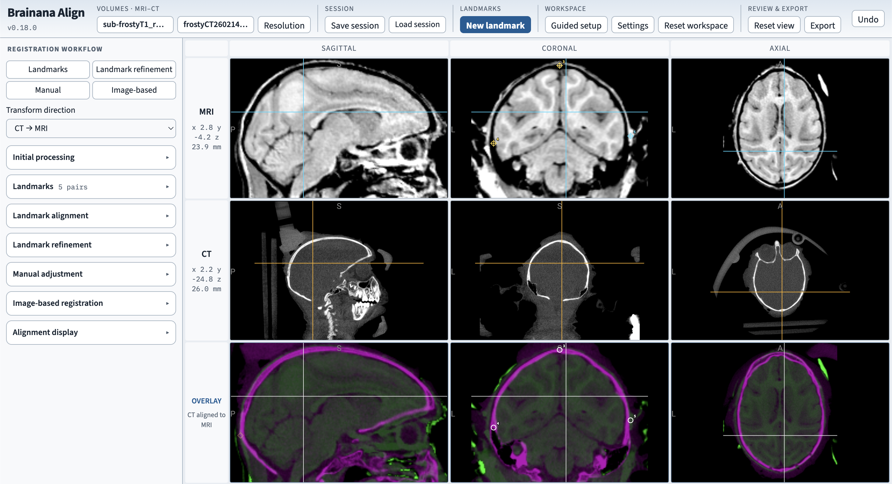

# Brainana Align

**Brainana Align** is a free, cross-platform desktop app for aligning brain images
using anatomical landmarks, manual adjustment and automated registration. It runs
on **macOS, Windows and Linux**, with its registration tools included in the app.

## Purpose and goals

Align was originally developed to register **CT images to MRI images of the same
brain**. Automated methods can struggle with this pairing, especially when implants
introduce imaging artifacts in the CT. The original focus was therefore
**landmark registration**: identify corresponding anatomical points in both images,
fit a transform, and inspect the result. A rigid transform can be sufficient for
images of the same brain when the underlying anatomy and physical scale agree;
**Rigid, 6 parameters** remains the default.

The app has since expanded to automated approaches, additional transform models
and other imaging modalities. We expect the main
[**Brainana analysis pipeline**](https://github.com/brainana/brainana) to be preferable
for most routine **T1, T2 and EPI registration** within a processing workflow.
Align is intended for individual alignment cases, hands-on inspection and
adjustment, and cases where automated registration is failing.

To incorporate **CT or other imaging modalities into a Brainana workflow**, we
recommend aligning them to the **processed T1 (or T2) output from the
[Brainana pipeline](https://github.com/brainana/brainana)** for the same subject.
Use that processed anatomical image as the **fixed/reference image** and the CT or
other image as the **moving image**. This places the additional modality in the
coordinate space of the processed anatomy used by the pipeline.

## Features

<p align="center">
  
</p>

- **Landmark registration** — Fit rigid (6 parameters), similarity (7), independent
  axis-scale (9) or affine (12) transforms from paired anatomical points. Advanced
  landmark splines support nonlinear fitting when needed.
- **Landmark refinement** — Make a constrained, image-based rigid adjustment to an
  accepted landmark alignment.
- **Manual adjustment** — Adjust an alignment interactively and inspect the overlay.
- **Image-based registration** — Run automated linear registration independently
  of landmarks. Optional JIP or ITK nonlinear registration follows an accepted
  linear alignment.
- **Preparation tools** — Prepare working images with tools such as cropping,
  masking and N4 bias correction.
- **Visual review** — Compare sagittal, coronal and axial slices using overlays,
  smooth opacity changes or fixed/moving image flips.
- **Guided setup and settings** — Follow the workflow step by step and customize
  the display and preferences.
- **Sessions and export** — Save your work and export accepted images and transforms
  with their physical-coordinate and registration metadata.

## Download & install

Download the build for your computer from the **[Releases page](https://github.com/brainana/brainana-align/releases/latest)**.

| Your system | Download |
|---|---|
| **macOS 14+ — Apple Silicon** (M1/M2/M3 and later) | `brainana-align-VERSION-arm64.dmg` |
| **macOS 14+ — Intel** | `brainana-align-VERSION-x64.dmg` |
| **Windows x64** | `brainana-align-setup-VERSION-x64.exe` |
| **Linux x64** (Ubuntu 22.04+ or compatible glibc 2.35+) | `brainana-align-VERSION-x86_64.AppImage` or `brainana-align-VERSION-amd64.deb` |

Not sure which Mac chip you have? Open **Apple menu → About This Mac**.
On macOS, open the DMG and drag **Brainana Align** into **Applications**, then launch
it from there. On Windows, run the installer; the portable ZIP is an alternative
that must be fully extracted before opening the app. On Linux, install the `.deb`
or make the AppImage executable as described below.

You do not need to install Node.js, Python, JIP, ITK or a separate registration app.
The **source ZIP** is for developers; the **full release ZIP** also includes the
installers, documentation, validation reports, manifests and SHA-256 checksums.

### First launch

The current macOS builds are **ad-hoc signed but not Apple-notarized**, and Windows
builds do not yet have an Authenticode publisher signature. Your system may block
the first launch or ask you to approve it. A new version may prompt again.

- **macOS:** Try opening the app once. If macOS says the developer cannot be
  verified or Apple cannot check it, open **System Settings → Privacy & Security**,
  find the blocked-app notice under **Security**, and choose **Open Anyway**.
  Authenticate and confirm **Open** if prompted. This is the path to use on recent
  macOS versions; see [Apple's instructions](https://support.apple.com/en-us/102445).
- **Windows:** If SmartScreen shows **Windows protected your PC**, select
  **More info → Run anyway** if available. On a managed computer, your administrator
  may need to approve the app. See [Microsoft's explanation](https://learn.microsoft.com/en-us/windows/apps/package-and-deploy/smartscreen-reputation).
- **Linux AppImage:** Right-click the downloaded file, open **Properties →
  Permissions**, and allow execution as a program. Alternatively, use `chmod +x`
  with the downloaded AppImage's filename, then double-click it. If it reports a
  FUSE error, use the `.deb` package or follow the
  [AppImage FUSE instructions](https://docs.appimage.org/user-guide/troubleshooting/fuse.html).
  The `.deb` does not need the executable-file step.

If a download is reported as **damaged** or will not open, download the correct
platform build again and compare its SHA-256 hash with `SHA256SUMS.txt` on the release
page. If it still fails, [report the exact message](https://github.com/brainana/brainana-align/issues)
with your OS version and asset filename. Keep system-wide security protections enabled.

## Quick start

1. **Load your images.** Choose the image pairing and load the two volumes. For
   CT-to-MRI work, check that the transform direction is **CT → MRI**. To align
   additional modalities with Brainana outputs, load the pipeline's **processed
   T1 or T2 as the fixed/reference image**, and the CT or other modality as the
   moving image. Click **Guided setup** for step-by-step help.
2. **Set corresponding landmarks.** Click **New landmark**, navigate to the same
   anatomical point in each image, and set its MRI and CT positions. Repeat with
   points spread across the anatomy; rigid fitting requires at least three
   non-collinear complete pairs. More well-distributed pairs help you assess the fit.
3. **Fit and inspect.** In **Landmark alignment**, leave **Rigid, 6 parameters**
   selected for a typical same-brain CT/MRI fit, then run alignment. Inspect the
   overlay and residual error in millimeters. Choose a different model only when
   the images require scale changes or a more flexible transform.
4. **Adjust or refine if needed.** Use **Manual adjustment** or **Landmark
   refinement**. For an independent automated approach, use **Image-based
   registration**. Review every proposed result before accepting it.
5. **Compare and save.** In **Alignment display → Image comparison**, choose smooth
   opacity or image flipping. Export the accepted result or **Save session** to
   continue later. Keep the original image files available for session restore.

### Which registration tool should I use?

| Tool | When to use it |
|---|---|
| **Landmark alignment** | You can identify matching anatomical points, especially when artifacts make intensity-based matching difficult. |
| **Landmark refinement** | You have accepted a landmark-derived alignment and want a small, constrained rigid improvement using image intensities. Its limits are separate from an independent automated search. |
| **Manual adjustment** | You want to adjust the alignment directly while inspecting the images. |
| **Image-based → Linear registration** | You want automated alignment without landmark pairs. Select the transform model and search settings, then review the proposal. |
| **Image-based → JIP nonlinear / ITK nonlinear B-spline** | You have accepted a linear alignment and need to model local deformation. These are different nonlinear methods; neither is required for a typical rigid same-brain CT/MRI fit. |

Optimization windows restrict the anatomy used for image-based matching. When
using them, define the intended regions before running registration. See the
[user documentation](Documentation/README.md) for preparation, windows, registration
settings and export details.

## Changes to JIP

Align includes a modified version of **JIP (Joe's Image Programs)**, developed by
**Joseph B. Mandeville at Massachusetts General Hospital / the Martinos Center**.
JIP supplies one of Align's nonlinear registration methods: after a linear
alignment is accepted, it estimates local displacements to improve the match.
Align's landmark fitting and linear registration are implemented separately.

The changes fall into three groups:

| Changes | What they address |
|---|---|
| **Numerical and image-geometry repairs** | Correct calculations used to penalize deformation and check distorted regions; make optimizer trials accept improvements or restore the previous state; correct inverse deformation and NIfTI geometry handling. These repairs can change results compared with the original JIP code. |
| **Reliability for large images and saved results** | Replace unsafe 32-bit size/index assumptions, check allocations and invalid values, and validate deformation files before restoring them. These changes address overflow, incomplete output and inconsistent restored state. |
| **Integration into Align** | Run JIP in a bundled worker, pass the accepted linear alignment and selected regions explicitly, convert image coordinates consistently, and support cancellation and recovery without closing the app. |

Later performance and platform work is tested against a **frozen reference copy
that already contains the earlier repairs**. Matching that reference checks that
later changes preserve the repaired behavior; it does not mean the repaired code
is identical to unmodified JIP, or that every registration is anatomically correct.

JIP's deformation grid and **ITK's cubic B-spline method are separate algorithms**.
The Windows ITK shutdown fix and installer/build changes are documented separately
from the JIP numerical repairs.

See the **[JIP changes and validation record](docs/jip-changes.md)** for a plain-language
walkthrough, the technical corrections, source and test links, and validation limits.
Original JIP copyright and MGH license notices are retained.

## Acknowledgements & references

Align builds on these projects and their authors' work:

| Software | Role in Align |
|---|---|
| [JIP — Joseph B. Mandeville / MGH](https://www.nmr.mgh.harvard.edu/~jbm/jip/) | Repaired/adapted native nonlinear registration, with the original MGH notices retained. |
| [ITK](https://itk.org/) | Native cubic B-spline nonlinear registration and N4 bias correction. N4 reference: [Tustison et al., 2010](https://doi.org/10.1109/TMI.2010.2046908). |
| [NiiVue](https://niivue.com/) | Image viewing and WebGL2 rendering. |
| [NumPy](https://numpy.org/) and [NiBabel](https://nipy.org/nibabel/) | Numerical arrays, physical-image geometry and scientific-worker NIfTI handling. |
| [FFTW](https://www.fftw.org/), [NIfTI C/znzlib](https://github.com/NIFTI-Imaging/nifti_clib), [zlib](https://zlib.net/) and lmfit/MINPACK | Native numerical and image-format support retained through JIP. |
| [Electron](https://www.electronjs.org/), [Node.js](https://nodejs.org/), [Python](https://www.python.org/) and [PyInstaller](https://pyinstaller.org/) | Dedicated desktop application, local services and bundled scientific worker. |
| [Brainana Viewer](https://github.com/brainana/brainana-viewer) | Organization/release reference and adapted SFTP/known-host code and tests. |

See **[software credits, component versions, licenses and scientific references](docs/software-credits.md)**
for the complete attribution guide, including frontend/data-access libraries and
test-only dependencies. AFNI/FSL/ANTs/elastix linear-default profiles reference
those tools' settings; their executables are not bundled as extra linear engines.

When reporting work performed with Align, record its version and the registration
and preparation methods you used. See the [scientific references](docs/software-credits.md#scientific-references)
for relevant citations and acknowledgements.

## Documentation & development

- [User documentation](Documentation/README.md)
- [Build and test](docs/building.md)
- [Publish a release](docs/publishing.md)
- [Architecture](docs/architecture.md)
- [Changelog](Documentation/CHANGELOG.md)
- [Maintenance contracts](AGENTS.md)

The repository contains the source. GitHub Actions compiles native installers and
checks the packaged workers for all four OS/CPU combinations listed above.
[The 0.18.0 qualification run](https://github.com/brainana/brainana-align/actions/runs/40609845201)
passed all four package jobs, browser checks and release assembly. Reports in each
release describe what was checked; headless tests do not certify native GPU
appearance or anatomical registration accuracy.

### Source organization

```
apps/align/          Desktop entry, server and readable TypeScript UI
packages/           Shared desktop, launcher, server, client and imaging mathematics
scientific/         Embedded numerical source, pinned vendor source and licenses
scripts/            Version, validation, packaging and CI orchestration
.github/            Source checks and native release matrix
tests/              Coordinate, region, scientific, worker, UI and lifecycle regressions
docs/               Contributor and publishing instructions
Documentation/      Consolidated user, technical and release documentation
```

### Build from source

Use Node.js 24 and Python 3.12 with the native toolchain described in
[Build and test](docs/building.md):

```sh
npm ci
npm run build
npm run ci:test
```

These commands build and test the frontend and core. Build the embedded numerical
engine before running `npm run dev:desktop`. Windows uses the documented MSYS2
MINGW64 toolchain.

## License

Align is **AGPL-3.0-only**; see [LICENSE](LICENSE) and [NOTICE.txt](NOTICE.txt).
Third-party components retain their original copyrights and license terms,
including JIP's MGH license and FFTW/ITK notices. See the
[software credits](docs/software-credits.md) and the licenses supplied with the source
and installers. The older repository snapshot remains in Git history, with its
[original BSD notice](licenses/Brainana-Align-original-BSD-3-Clause.txt) preserved.
